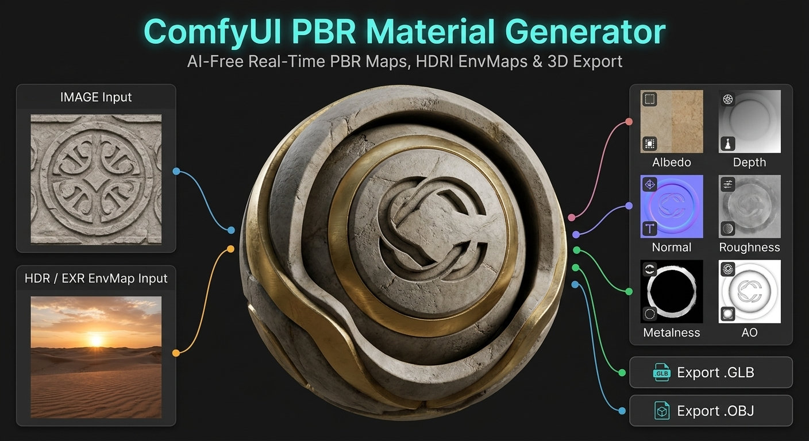

# ComfyUI PBR Material Generator

🌐 **Language / Sprache / Langue / Idioma / Язык / 语言:**  
[ English](#english) | [ Deutsch](#deutsch) | [ Français](#français) | [ Español](#español) | [ Русский](#русский) | [ 中文](#中文)

---

##  English

### ⚡ Ultra-Fast, AI-Free PBR Map Generation & Real-Time 3D Preview

An all-in-one **PBR Material Generator & Interactive Three.js 3D Preview Node** for ComfyUI. Because **no AI models are required**, all maps are computed **ultra-fast in real time** via pure GPU shader math. Generate **Albedo (De-Lit Base Color)**, **Depth/Height**, **Normal (Macro + Micro Detail Mix)**, **Roughness**, **Metalness**, and **Multi-Scale Ambient Occlusion** maps from a single image—or optionally connect your own custom PBR maps and HDR/EXR environment maps—and inspect, relight, and export the displaced mesh as **GLB** or **OBJ** directly inside ComfyUI.

### :sparkles: Features

- :zap: **Ultra-Fast, AI-Free Full PBR Generation:** Computes 6 PBR outputs instantly using pure shader-style GPU math (no AI weights or heavy model downloads required) from a single `IMAGE` input:
  - `base_color` with optional **Albedo De-Lighting** (`delight_strength`) to remove baked-in shadows and highlights.
  - `depth_map` with adjustable contrast, smoothness, and depth inversion.
  - `normal_map` combining macro smoothness and high-frequency micro-detail blending (`detail_mix`) plus OpenGL/DirectX Y-axis flip (`invert_normal_y`).
  - `roughness_map` with configurable base roughness (`roughness_base`), contrast, and inversion.
  - `metalness_map` via luminance and chroma thresholding.
  - `ao_map` via multi-scale cavity/horizon occlusion.
- :electric_plug: **Optional Custom Map Inputs:** Optionally plug in your own external maps (`height_depth`, `normal_map`, `roughness_map`, `metalness_map`, `ao_map`, or `env_map`) to inspect them directly inside the 3D viewer.
- :package: **10 Built-in 3D Preview Meshes:** Switch live between `Plane (Relief)`, `Box`, `Sphere`, `Cylinder`, `Cone`, `Torus`, `TorusKnot`, `Capsule`, `Dodecahedron`, and `Icosahedron` with seamless edge-faded displacement.
- :bulb: **9 Kelvin Lighting Presets:** From `Candle (1900 K)` and `Gallery Warm (3200 K)` to `Daylight (5500 K)`, `Overcast (7500 K)`, and `Gallery Contrast (3000K / 7000K)`.
- :globe_with_meridians: **Environment Lighting & UV Tiling:** Toggle environment background visibility (`Env BG`), adjust `Env Int` and real-time `Env Blur`, and test seamless tiling (`1x` – `4x`).
- 🖼️ **Gallery Frame & Solo Map Inspection:** Preview with optional dark or bronze shadow-gap frames, wireframe overlay, and solo map views (`Base`, `Depth`, `Normal`, `Roughness`, `Metalness`, `AO`).
- :floppy_disk: **1-Click Baked 3D Export:** Export displaced geometry directly to binary **`.glb`**, **`.obj`**, or high-res **`.png`** preview screenshot, or copy material settings via **Copy Config**.
- :white_check_mark: **100% Offline Ready:** Bundles Three.js locally (`web/three_bundle.min.js`) with zero external CDN requests at runtime.

### :wrench: Installation

#### Option 1: Via ComfyUI Manager (Recommended)
1. Open **ComfyUI Manager** → **Custom Nodes Manager**.
2. Search for **`ComfyUI PBR Material Generator`** (or **`PBR Material Generator`**) and click **Install**.
3. Restart ComfyUI and refresh your browser (`Ctrl + Shift + R`).

#### Option 2: Manual Installation (Git)
1. Navigate to your ComfyUI `custom_nodes` directory:
   cd ComfyUI/custom_nodes
2. Clone this repository:
   git clone https://github.com/aimpowerment/ComfyUI-PBR-Material-Generator.git
3. Restart ComfyUI and refresh your browser (`Ctrl + Shift + R`).

### :rocket: Usage

1. Add the node via **Right-Click → Add Node → 3D/Preview → `PBR Material Generator`**.
2. Connect any `IMAGE` to the `image` input and click **Run**.
3. Use the interactive HUD (top-right) to tune displacement depth, normal strength, roughness, metalness, AO, light intensity, environment intensity, and environment blur in real time.
4. Use the bottom bar to switch 3D primitives, inspect solo maps, change Kelvin lighting temperatures, toggle UV tiling (`1x`–`4x`), or export your displaced mesh as `.glb` or `.obj`.

### :scroll: License & Third-Party References

- Code in this repository is licensed under the **Apache License 2.0.** (attribution required).
- Powered by [Three.js](https://threejs.org/) (r170) for WebGL 3D rendering, orbit controls, and GLB/OBJ exporters, and [fflate](https://github.com/101arrowz/fflate) (0.8.2) for compression, both licensed under the **MIT License**. See `THIRD-PARTY-LICENSES.txt` for full license notices.

[↑ Back to top](#top)

---

##   Deutsch

### ⚡ Superschnelle PBR-Generierung ohne KI & Echtzeit-3D-Vorschau

Eine All-in-One-Node für **PBR-Material-Generierung & interaktive Three.js 3D-Vorschau** in ComfyUI, die komplett ohne KI-Modelle auskommt und alle Maps (Albedo, Depth, Normal, Roughness, Metalness und Ambient Occlusion) per GPU-Shader in Echtzeit berechnet. Das fertige Relief kann direkt als GLB oder OBJ exportiert werden.

### :sparkles: Funktionen

- :zap: **Superschnelle PBR-Generierung ohne KI:** Berechnet 6 PBR-Outputs verzögerungsfrei aus einem einzigen `IMAGE`-Eingang (inklusive Albedo De-Lighting, Depth, Normal-Mix, Roughness, Metalness und AO).
- :electric_plug: **Optionale eigene Maps:** Unterstützt das Einbinden eigener externer Maps (`height_depth`, `normal_map`, `roughness_map`, `metalness_map`, `ao_map`, `env_map`).
- :package: **10 integrierte 3D-Objekte:** Wechseln Sie live zwischen Plane, Box, Sphere, Cylinder, Cone, Torus, TorusKnot, Capsule, Dodecahedron und Icosahedron.
- :bulb: **9 Kelvin-Lichtprofile & Umgebung:** Von Candle (1900 K) über Daylight (5500 K) bis Gallery Contrast, inklusive Live-Hintergrund und UV-Tiling (`1x`–`4x`).
- 🖼️ **Galerierahmen & Exporte:** Bietet Solo-Ansichten, Wireframe-Modus sowie einen 1-Klick-Export als `.glb`, `.obj` oder `.png`-Screenshot.
- :white_check_mark: **100 % Offline-fähig:** Inklusive lokalem Three.js-Bundle (`web/three_bundle.min.js`) ganz ohne externe Laufzeit-Abhängigkeiten.

### :wrench: Installation

#### Option 1: Über den ComfyUI Manager (Empfohlen)
1. Öffne den **ComfyUI Manager** → **Custom Nodes Manager**.
2. Suche nach **`ComfyUI PBR Material Generator`** und klicke auf **Install**.
3. Starte ComfyUI neu und lade den Browser neu (`Strg + Shift + R`).

#### Option 2: Manuelle Installation (Git)
1. Wechsle in das Verzeichnis `ComfyUI/custom_nodes`.
2. Klone das Repository: `git clone https://github.com/aimpowerment/ComfyUI-PBR-Material-Generator.git`
3. Starte ComfyUI neu und lade den Browser neu (`Strg + Shift + R`).

### :rocket: Verwendung

1. Füge die Node über **Rechtsklick → Add Node → 3D/Preview → `PBR Material Generator`** hinzu.
2. Verbinde ein `IMAGE` mit dem Eingang und klicke auf **Run**.
3. Passe Parameter wie Tiefe, Normal-Stärke, Roughness oder Lichtprofile direkt im HUD und der unteren Leiste an.

### :scroll: Lizenz & Referenzen auf Drittanbieter-Software

- Der Code steht unter der **Apache License 2.0**.
- Basiert auf [Three.js](https://threejs.org) (r170) und [fflate](https://github.com) (0.8.2) unter der **MIT-Lizenz** (vollständige Hinweise in `THIRD-PARTY-LICENSES.txt`).

[↑ Nach oben](#top)

---

##  Français

### ⚡ Génération PBR ultra-rapide sans IA & Aperçu 3D en temps réel

Un nœud tout-en-un **Générateur de matériaux PBR et Aperçu 3D interactif Three.js** pour ComfyUI. Comme **aucun modèle d'IA n'est requis**, toutes les cartes sont calculées **ultra-rapidement en temps réel** par de purs calculs mathématiques GPU de type shader. Générez des cartes **Albédo (Base Color dé-éclairée)**, **Profondeur/Hauteur**, **Normale (Mélange macro + micro-détails)**, **Rugosité**, **Métallicité** et **Occlusion ambiante multi-échelle** à partir d'une seule image — ou connectez optionnellement vos propres cartes PBR et environnements HDR/EXR — puis inspectez, éclairez et exportez le maillage déplacé au format **GLB** ou **OBJ** directement dans ComfyUI.

### :sparkles: Fonctionnalités

- :zap: **Génération PBR ultra-rapide et 100 % sans IA :** Calcule instantanément 6 sorties PBR par calcul mathématique GPU (sans poids d'IA ni téléchargement de modèles lourds) depuis une seule entrée `IMAGE` :
  - `base_color` avec suppression optionnelle des ombres et reflets intégrés (**De-Lighting**, `delight_strength`).
  - `depth_map` avec contraste, lissage et inversion réglables.
  - `normal_map` combinant lissage macro, détails fins (`detail_mix`) et inversion de l'axe Y OpenGL/DirectX (`invert_normal_y`).
  - `roughness_map` avec rugosité de base (`roughness_base`), contraste et inversion.
  - `metalness_map` basée sur la luminance et la saturation chromatique.
  - `ao_map` par occlusion de cavité multi-échelle.
- :electric_plug: **Cartes personnalisées optionnelles :** Permet de connecter optionnellement vos propres cartes externes (`height_depth`, `normal_map`, `roughness_map`, `metalness_map`, `ao_map` ou `env_map`) pour les visualiser directement dans l'aperçu 3D.
- :package: **10 objets 3D intégrés :** Basculez en direct entre `Plane (Relief)`, `Box`, `Sphere`, `Cylinder`, `Cone`, `Torus`, `TorusKnot`, `Capsule`, `Dodecahedron` et `Icosahedron` avec déplacement progressif sur les bords.
- :bulb: **9 préréglages d'éclairage Kelvin :** De `Candle (1900 K)` et `Gallery Warm (3200 K)` à `Daylight (5500 K)`, `Overcast (7500 K)` et `Gallery Contrast (3000K / 7000K)`.
- :globe_with_meridians: **Éclairage d'environnement & Répétition UV :** Activez/désactivez l'arrière-plan (`Env BG`), réglez `Env Int` et `Env Blur` en temps réel, et testez la répétition (`1x` – `4x`).
- 🖼️ **Cadre de galerie & Inspection individuelle :** Aperçu avec cadre sombre ou bronze, mode filaire et vue individuelle des cartes (`Base`, `Depth`, `Normal`, `Roughness`, `Metalness`, `AO`).
- :floppy_disk: **Exportation 3D en un clic :** Exportez la géométrie déplacée en **`.glb`**, **`.obj`**, capture **`.png`**, ou copiez la configuration via **Copy Config**.
- :white_check_mark: **100 % hors ligne :** Intègre Three.js localement (`web/three_bundle.min.js`) sans aucune requête CDN externe.

### :wrench: Installation

#### Option 1 : Via ComfyUI Manager (Recommandé)
1. Ouvrez **ComfyUI Manager** → **Custom Nodes Manager**.
2. Recherchez **`ComfyUI PBR Material Generator`** (ou **`PBR Material Generator`**) et cliquez sur **Install**.
3. Redémarrez ComfyUI et actualisez votre navigateur (`Ctrl + Shift + R`).

#### Option 2 : Installation manuelle (Git)
1. Accédez au dossier `custom_nodes` de ComfyUI :
   cd ComfyUI/custom_nodes
2. Clonez ce dépôt :
   git clone https://github.com/aimpowerment/ComfyUI-PBR-Material-Generator.git
3. Redémarrez ComfyUI et actualisez votre navigateur (`Ctrl + Shift + R`).

### :rocket: Utilisation

1. Ajoutez le nœud via **Clic droit → Add Node → 3D/Preview → `PBR Material Generator`**.
2. Connectez une `IMAGE` à l'entrée `image` et cliquez sur **Run**.
3. Utilisez le HUD interactif (en haut à droite) pour ajuster en temps réel la profondeur, l'intensité des normales, la rugosité, la métallicité, l'AO et l'éclairage.
4. Utilisez la barre inférieure pour changer d'objet 3D, inspecter les cartes individuellement, modifier la température Kelvin, tester la répétition UV (`1x`–`4x`) ou exporter en `.glb` / `.obj`.

### :scroll: Licence & Références tierces

- Le code de ce dépôt est sous **Apache License 2.0.** (mention de l'auteur requise).
- Propulsé par [Three.js](https://threejs.org/) (r170) pour le rendu 3D WebGL, les contrôles orbitaux et les exportateurs GLB/OBJ, ainsi que [fflate](https://github.com/101arrowz/fflate) (0.8.2) pour la compression (tous deux sous **licence MIT**). Consultez `THIRD-PARTY-LICENSES.txt` pour les mentions complètes.

[↑ Haut de page](#top)
---

##  Español

### ⚡ Generación PBR ultrarrápida sin IA y vista previa 3D en tiempo real

Un nodo todo en uno de **Generador de Materiales PBR y Vista Previa 3D Interactiva con Three.js** para ComfyUI. Dado que **no se requieren modelos de IA**, todos los mapas se calculan **ultrarrápidamente en tiempo real** mediante pura matemática de shaders en GPU. Genera mapas de **Albedo (Color Base sin iluminación horneada)**, **Profundidad/Altura**, **Normales (Mezcla macro + microdetalles)**, **Rugosidad**, **Metalicidad** y **Oclusión Ambiental multiescala** a partir de una sola imagen —o conecta opcionalmente tus propios mapas PBR y entornos HDR/EXR— e inspecciona, ilumina y exporta la malla desplazada como **GLB** u **OBJ** directamente dentro de ComfyUI.

### :sparkles: Características

- :zap: **Generación PBR ultrarrápida y 100 % sin IA:** Calcula 6 salidas PBR al instante mediante pura matemática GPU de shaders (sin pesos de IA ni descargas de modelos pesados) desde una sola entrada `IMAGE`:
  - `base_color` con eliminación opcional de sombras y brillos (**De-Lighting**, `delight_strength`).
  - `depth_map` con contraste, suavizado e inversión ajustables.
  - `normal_map` que combina suavizado macro, microdetalles (`detail_mix`) e inversión del eje Y OpenGL/DirectX (`invert_normal_y`).
  - `roughness_map` con rugosidad base (`roughness_base`), contraste e inversión.
  - `metalness_map` mediante umbral de luminancia y croma.
  - `ao_map` mediante oclusión de cavidades multiescala.
- :electric_plug: **Entradas opcionales de mapas personalizados:** Permite conectar opcionalmente tus propios mapas externos (`height_depth`, `normal_map`, `roughness_map`, `metalness_map`, `ao_map` o `env_map`) para visualizarlos directamente en el visor 3D.
- :package: **10 mallas 3D integradas:** Cambia en vivo entre `Plane (Relief)`, `Box`, `Sphere`, `Cylinder`, `Cone`, `Torus`, `TorusKnot`, `Capsule`, `Dodecahedron` e `Icosahedron` con desplazamiento suavizado en los bordes.
- :bulb: **9 perfiles de iluminación Kelvin:** Desde `Candle (1900 K)` y `Gallery Warm (3200 K)` hasta `Daylight (5500 K)`, `Overcast (7500 K)` y `Gallery Contrast (3000K / 7000K)`.
- :globe_with_meridians: **Iluminación de entorno y repetición UV:** Alterna el fondo (`Env BG`), ajusta `Env Int` y `Env Blur` en tiempo real y prueba el mosaico UV (`1x` – `4x`).
- 🖼️ **Marco de galería e inspección individual:** Vista previa con marco oscuro o bronce, malla alámbrica y vista individual (`Base`, `Depth`, `Normal`, `Roughness`, `Metalness`, `AO`).
- :floppy_disk: **Exportación 3D en 1 clic:** Exporta la geometría desplazada en **`.glb`**, **`.obj`**, captura **`.png`** o copia los parámetros con **Copy Config**.
- :white_check_mark: **100 % sin conexión:** Incluye Three.js localmente (`web/three_bundle.min.js`) sin peticiones a CDN externos.

### :wrench: Instalación

#### Opción 1: A través de ComfyUI Manager (Recomendado)
1. Abre **ComfyUI Manager** → **Custom Nodes Manager**.
2. Busca **`ComfyUI PBR Material Generator`** (o **`PBR Material Generator`**) y haz clic en **Install**.
3. Reinicia ComfyUI y recarga tu navegador (`Ctrl + Shift + R`).

#### Opción 2: Instalación manual (Git)
1. Ve a la carpeta `custom_nodes` de tu ComfyUI:
   cd ComfyUI/custom_nodes
2. Clona este repositorio:
   git clone https://github.com/aimpowerment/ComfyUI-PBR-Material-Generator.git
3. Reinicia ComfyUI y recarga el navegador (`Ctrl + Shift + R`).

### :rocket: Uso

1. Añade el nodo mediante **Clic derecho → Add Node → 3D/Preview → `PBR Material Generator`**.
2. Conecta cualquier `IMAGE` a la entrada `image` y pulsa **Run**.
3. Usa el HUD interactivo (arriba a la derecha) para ajustar en tiempo real la profundidad, fuerza de normales, rugosidad, metalicidad, AO e iluminación.
4. Usa la barra inferior para cambiar de geometría 3D, inspeccionar mapas individuales, cambiar la temperatura Kelvin, probar la repetición UV (`1x`–`4x`) o exportar en `.glb` / `.obj`.

### :scroll: Licencia y referencias de terceros

- El código de este repositorio está bajo la **Licencia Apache 2.0.** (requiere atribución).
- Impulsado por [Three.js](https://threejs.org/) (r170) para el renderizado 3D WebGL, controles orbitales y exportadores GLB/OBJ, y [fflate](https://github.com/101arrowz/fflate) (0.8.2) para la compresión (ambos bajo la **Licencia MIT**). Consulta `THIRD-PARTY-LICENSES.txt` para ver los avisos completos.

[↑ Volver arriba](#top)
---

##  Русский

### ⚡ Сверхбыстрая генерация PBR-карт без ИИ и 3D-просмотр в реальном времени

Универсальный узел **Генератор PBR-материалов и интерактивный 3D-просмотрщик на Three.js** для ComfyUI. Поскольку **модели ИИ не требуются**, все карты вычисляются **сверхбыстро в реальном времени** с помощью чистой шейдерной математики на GPU. Создавайте карты **Альбедо (очищенный Base Color)**, **Глубины/Высот (Depth)**, **Нормалей (смешивание макро- и микродеталей)**, **Шероховатости (Roughness)**, **Металличности (Metalness)** и **Многомасштабного затенения (AO)** из одного изображения — или опционально подключайте собственные PBR-карты и HDR/EXR-окружения — а также настраивайте освещение и экспортируйте готовую 3D-модель в **GLB** или **OBJ** прямо внутри ComfyUI.

### :sparkles: Возможности

- :zap: **Сверхбыстрая генерация PBR без ИИ:** Мгновенно вычисляет 6 PBR-выходов с помощью чистой шейдерной математики GPU (без весов ИИ и загрузки тяжелых моделей) из одного входа `IMAGE`:
  - `base_color` с функцией удаления запеченных теней и бликов (**De-Lighting**, `delight_strength`).
  - `depth_map` с настройкой контраста, сглаживания и инверсии.
  - `normal_map` с комбинацией макро-формы, микродеталей (`detail_mix`) и переключением оси Y OpenGL/DirectX (`invert_normal_y`).
  - `roughness_map` с настройкой базовой шероховатости (`roughness_base`), контраста и инверсии.
  - `metalness_map` на основе яркости и цветовой насыщенности.
  - `ao_map` на основе многомасштабного затенения полостей.
- :electric_plug: **Опциональные пользовательские карты:** Позволяет опционально подключать собственные внешние карты (`height_depth`, `normal_map`, `roughness_map`, `metalness_map`, `ao_map` или `env_map`) для их прямого отображения в 3D-просмотрщике.
- :package: **10 встроенных 3D-примитивов:** Мгновенное переключение между `Plane (Relief)`, `Box`, `Sphere`, `Cylinder`, `Cone`, `Torus`, `TorusKnot`, `Capsule`, `Dodecahedron` и `Icosahedron` с плавным затуханием смещения по краям.
- :bulb: **9 пресетов освещения по Кельвину:** От `Candle (1900 K)` и `Gallery Warm (3200 K)` до `Daylight (5500 K)`, `Overcast (7500 K)` и `Gallery Contrast (3000K / 7000K)`.
- :globe_with_meridians: **Окружение и тайлинг UV:** Управление фоном (`Env BG`), интенсивностью (`Env Int`), размытием фона (`Env Blur`) и тайлингом текстур (`1x` – `4x`).
- 🖼️ **Галерейная рамка и просмотр отдельных карт:** Темная или бронзовая рамка, каркас (Wireframe) и режим просмотра отдельных слоев (`Base`, `Depth`, `Normal`, `Roughness`, `Metalness`, `AO`).
- :floppy_disk: **Экспорт 3D в один клик:** Экспорт геометрии со смещением в бинарный **`.glb`**, **`.obj`**, скриншот **`.png`** или копирование настроек через **Copy Config**.
- :white_check_mark: **Полностью автономная работа:** Библиотека Three.js встроена локально (`web/three_bundle.min.js`) без обращения к внешним CDN.

### :wrench: Установка

#### Вариант 1: Через ComfyUI Manager (Рекомендуется)
1. Откройте **ComfyUI Manager** → **Custom Nodes Manager**.
2. Найдите **`ComfyUI PBR Material Generator`** (или **`PBR Material Generator`**) и нажмите **Install**.
3. Перезапустите ComfyUI и обновите страницу в браузере (`Ctrl + Shift + R`).

#### Вариант 2: Ручная установка (Git)
1. Перейдите в папку `custom_nodes` вашего ComfyUI:
   cd ComfyUI/custom_nodes
2. Клонируйте репозиторий:
   git clone https://github.com/aimpowerment/ComfyUI-PBR-Material-Generator.git
3. Перезапустите ComfyUI и обновите страницу в браузере (`Ctrl + Shift + R`).

### :rocket: Использование

1. Добавьте узел через **ПКМ → Add Node → 3D/Preview → `PBR Material Generator`**.
2. Подключите любое `IMAGE` ко входу `image` и нажмите **Run**.
3. Используйте интерактивный HUD (справа сверху) для настройки глубины, силы нормалей, шероховатости, металличности, AO и освещения в реальном времени.
4. Используйте нижнюю панель для смены 3D-примитивов, просмотра отдельных карт, выбора температуры Кельвина, тайлинга UV (`1x`–`4x`) или экспорта в `.glb` / `.obj`.

### :scroll: Лицензия и сторонние компоненты

- Код в этом репозитории распространяется под **лицензией Apache 2.0.** (с обязательным указанием авторства).
- Работает на базе [Three.js](https://threejs.org/) (r170) для 3D-рендеринга WebGL, управления камерой и экспортеров GLB/OBJ, а также [fflate](https://github.com/101arrowz/fflate) (0.8.2) для сжатия данных (оба под **лицензией MIT**). Полные уведомления о лицензиях см. в файле `THIRD-PARTY-LICENSES.txt`.

[↑ Наверх](#top)
---

##  中文

### ⚡ 无需 AI 的超高速 PBR 贴图生成与实时 3D 预览

适用于 ComfyUI 的一体化 **PBR 材质生成器与 Three.js 交互式 3D 预览节点**。由于**完全无需任何 AI 模型**，所有贴图均通过纯 GPU 着色器数学运算**超高速实时生成**。只需输入单张图像，即可自动生成 **反照率贴图（去光影 Base Color）**、**深度/高度图（Depth）**、**法线贴图（宏微观细节混合）**、**粗糙度贴图（Roughness）**、**金属度贴图（Metalness）** 以及 **多尺度环境光遮蔽贴图（AO）**——同时支持可选接入自定义 PBR 贴图与 HDR/EXR 环境贴图，并可在 ComfyUI 内直接进行实时打光预览及导出烘焙后的 **GLB / OBJ** 模型。

### :sparkles: 主要功能

- :zap: **无需 AI 的超高速全套 PBR 生成：** 通过纯 GPU 着色器数学算法从单个 `IMAGE` 输入瞬间计算 6 路 PBR 输出（无需 AI 权重或下载大型模型）：
  - `base_color`：支持去光影处理（`delight_strength`），消除原图中的烘焙阴影与高光。
  - `depth_map`：支持对比度、平滑度与深度反转调节。
  - `normal_map`：融合宏观平滑与高频微观细节（`detail_mix`），支持 OpenGL/DirectX Y 轴翻转（`invert_normal_y`）。
  - `roughness_map`：支持基础粗糙度（`roughness_base`）、对比度及反转调节。
  - `metalness_map`：基于亮度与色彩饱和度阈值自动提取金属区域。
  - `ao_map`：基于多尺度凹陷/地平线遮蔽算法生成环境光遮蔽。
- :electric_plug: **可选自定义贴图输入：** 支持可选接入外部贴图（`height_depth`、`normal_map`、`roughness_map`、`metalness_map`、`ao_map` 或 `env_map`），直接在 3D 预览器中进行查看与打光。
- :package: **内置 10 种 3D 预览几何体：** 实时切换 `Plane (Relief)`、`Box`、`Sphere`、`Cylinder`、`Cone`、`Torus`、`TorusKnot`、`Capsule`、`Dodecahedron` 和 `Icosahedron`，支持边缘平滑过渡位移。
- :bulb: **9 种开尔文（Kelvin）色温灯光预设：** 涵盖 `Candle (1900 K)`、`Gallery Warm (3200 K)`、`Daylight (5500 K)`、`Overcast (7500 K)` 及 `Gallery Contrast (3000K / 7000K)`。
- :globe_with_meridians: **环境照明与 UV 平铺测试：** 支持环境背景开关（`Env BG`）、环境强度（`Env Int`）、实时背景模糊（`Env Blur`）以及 `1x`–`4x` 无缝平铺预览。
- 🖼️ **画廊画框与单通道检查：** 支持深色/青铜悬浮画框、线框模式及各贴图单独查看（`Base`、`Depth`、`Normal`、`Roughness`、`Metalness`、`AO`）。
- :floppy_disk: **一键导出烘焙 3D 模型：** 直接导出带位移细节的 **`.glb`**、**`.obj`** 模型或 **`.png`** 预览图，也可通过 **Copy Config** 复制当前材质参数。
- :white_check_mark: **100% 离线运行：** 本地集成 Three.js（`web/three_bundle.min.js`），运行时无需任何外部 CDN 请求。

### :wrench: 安装方法

#### 方式一：通过 ComfyUI Manager 安装（推荐）
1. 打开 **ComfyUI Manager** → **Custom Nodes Manager**。
2. 搜索 **`ComfyUI PBR Material Generator`**（或 **`PBR Material Generator`**）并点击 **Install**。
3. 重启 ComfyUI 并强制刷新浏览器（`Ctrl + Shift + R`）。

#### 方式二：手动安装（Git）
1. 进入 ComfyUI 的 `custom_nodes` 目录：
   cd ComfyUI/custom_nodes
2. 克隆本仓库：
   git clone https://github.com/aimpowerment/ComfyUI-PBR-Material-Generator.git
3. 重启 ComfyUI 并强制刷新浏览器（`Ctrl + Shift + R`）。

### :rocket: 使用方法

1. 通过 **右键 → Add Node → 3D/Preview → `PBR Material Generator`** 添加节点。
2. 将任意 `IMAGE` 连接到 `image` 输入端口并点击 **Run**。
3. 使用右上角的交互式 HUD 实时调节位移深度、法线强度、粗糙度、金属度、AO 及光照参数。
4. 使用底部工具栏切换 3D 几何体、单独查看各贴图、更改开尔文色温预设、测试 UV 平铺（`1x`–`4x`）或导出为 `.glb` / `.obj`。

### :scroll: 开源协议与第三方引用

- 本仓库代码采用 **Apache 2.0. 许可证**（需保留署名）。
- 由 [Three.js](https://threejs.org/) (r170) 提供 WebGL 3D 渲染、轨道控制及 GLB/OBJ 导出功能，并由 [fflate](https://github.com/101arrowz/fflate) (0.8.2) 提供数据压缩支持（两者均采用 **MIT 许可证**）。完整许可声明请参阅 `THIRD-PARTY-LICENSES.txt`。

[↑ 返回顶部](#top)
